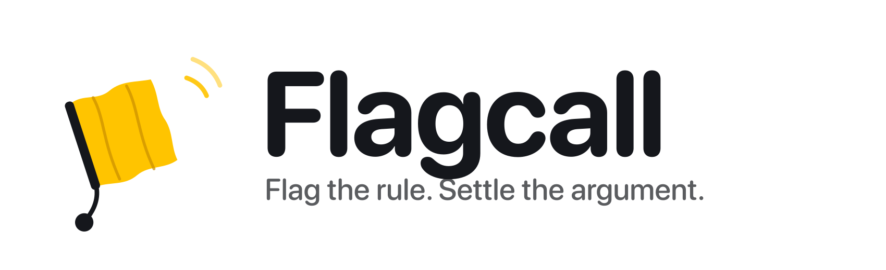
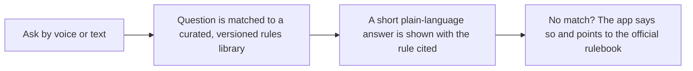

<div align="center">
  <picture>
    <source media="(prefers-color-scheme: dark)" srcset="branding/flagcall-wordmark-on-dark.png">
    
  </picture>

  <p><strong>Flag the rule. Settle the argument.</strong></p>

     
</div>

> **Status: in design.** Flagcall is a fully briefed and branded product concept. The plan, scope and open questions are documented; the app has not been built yet.

## The idea

Ask a rules question by voice or text and get a short, correct answer with the rule cited, for pickup games and rec leagues.

- **For:** Players, coaches, parents and league organizers in pickup games and rec leagues.
- **Outcome:** Settle a rules argument on the spot with a trustworthy, citable answer.

## How it will work



## Planned features

- Voice input with on-device speech recognition where available
- Curated plain-language rules library (original summaries, rule-number citations)
- Language model, if used, only rephrases an already-selected entry and never supplies rule numbers or facts
- Says "not sure" instead of guessing
- Proposed first sports: pickleball, softball, disc golf, youth soccer

## Tech plan

| Layer | Choice |
|---|---|
| Language / UI | Swift, SwiftUI (iOS 17+) |
| Speech | On-device speech recognition |
| Content | Curated, versioned rules library |
| Backend | None |

## Privacy by design

Questions are answered from a bundled rules library. Unofficial and not affiliated with any governing body.

## Open decisions

Tracked openly in [`docs/PROJECT_BRIEF.md`](docs/PROJECT_BRIEF.md). A few of the big ones:

- Which sport ships first, and which rulebook edition and year?
- Rulebooks are copyrighted by their governing bodies. Plan: original plain-language summaries with rule-number citations, no copied text. Needs confirmation, and possibly permission, before launch.
- Required "unofficial / not affiliated" wording.
- How to reuse the rules-matching approach from the golf app: separate rewrite, or shared package? (Affects repo structure.)

## Brand

| | Name | Hex | Role |
|---|---|---|---|
|  | Flag Yellow | `#FFC400` | Flag, accent, rule citations |
|  | Referee Black | `#15171C` | Icon field, text, dark surfaces |
|  | White | `#FFFFFF` | Flag cuff, light surfaces |
|  | Turf | `#2E7D4F` | Confirmation states |

**Mark.** A football referee's penalty flag, thrown: yellow cloth, white weighted cuff and tail, with motion streaks. The call, made.

**Voice.** Short, direct, fair. Give the ruling first, then the rule number. No hedging when the rule is clear; say plainly when it is not.

Full logo set (mark, wordmark, app icon in light and dark) and the brand guide are in [`branding/`](branding/BRAND_GUIDE.md).

## Repository contents

```
docs/PROJECT_BRIEF.md   Confirmed requirements, assumptions, open questions, scope
branding/               Logo files and BRAND_GUIDE.md
```

## License

Proprietary. Shared publicly for portfolio and demonstration purposes only. See [LICENSE](LICENSE).

---

<div align="center">

Built by [Aquila Digital LLC](https://github.com/Steven6Brown) · *Per Aspera Ad Astra*

</div>
